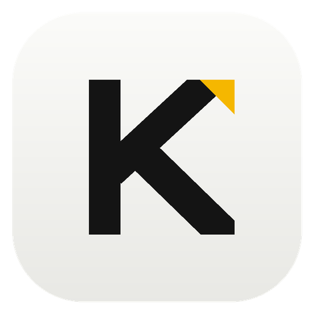
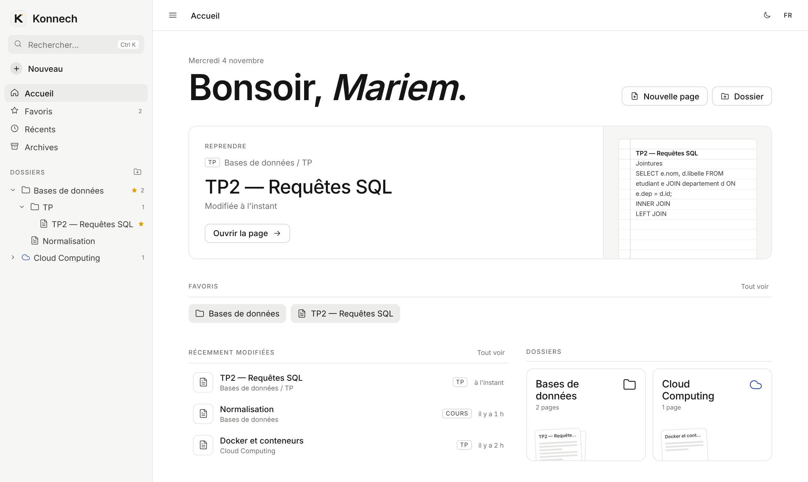
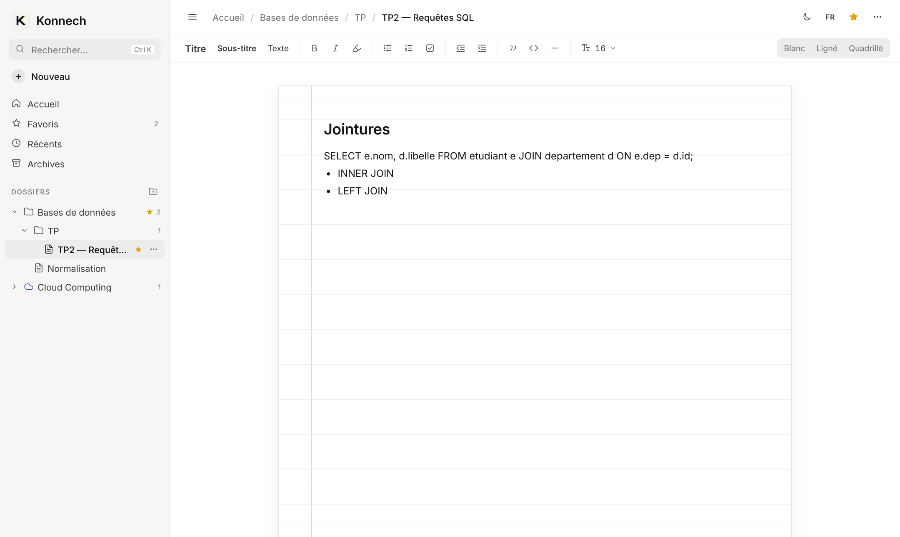

<p align="center">
  
</p>

<h1 align="center">Konnech</h1>

<p align="center">
  Un carnet de notes de bureau, simple et hors ligne, pour ranger ses cours, TP et projets.<br>
  <em>A simple, offline desktop notebook to organise your courses, labs and projects.</em>
</p>

<p align="center">
  
  
  
  
</p>

<p align="center">
  
</p>

---

**Konnech** vient de *كنّاش* (kannech), « carnet » en tunisien. C'est un notebook personnel : des dossiers, des pages, et une feuille sur laquelle on écrit directement. Tout reste sur votre ordinateur.

## Sommaire

- [Fonctionnalités](#fonctionnalités)
- [Installation](#installation)
- [Où sont enregistrées vos notes](#où-sont-enregistrées-vos-notes)
- [Sauvegarde et transfert vers un autre PC](#sauvegarde-et-transfert-vers-un-autre-pc)
- [Confidentialité](#confidentialité)
- [Raccourcis clavier](#raccourcis-clavier)
- [Compiler depuis le code source](#compiler-depuis-le-code-source)
- [English](#english)

## Fonctionnalités

**Organisation**
- Dossiers et sous-dossiers sans limite de profondeur, avec icône et couleur au choix.
- Pages classées par type : Cours, TP, TD, Projet, Note.
- Favoris, pages récentes et archives (on met de côté sans supprimer).
- Recherche dans les noms **et** dans le contenu des pages (`Ctrl K`).

**Écriture**
- Titres, sous-titres, gras, italique, listes, cases à cocher, citations, blocs de code.
- Surligneur fluo (jaune, vert, rose, bleu, orange).
- Retraits avec `Tab` / `Maj+Tab`.
- Taille du texte réglable par page, papier blanc, ligné ou quadrillé.
- Enregistrement automatique pendant la frappe.

**Confort**
- Interface en français ou en anglais.
- Thème clair et sombre.
- Barre latérale repliable.
- Accueil personnalisé avec votre prénom.

<p align="center">
  
</p>

## Installation

1. Téléchargez **`Konnech-Windows.zip`** depuis la page [Releases](../../releases/latest).
2. Faites un clic droit sur le zip, puis **Extraire tout**.
3. Ouvrez le dossier extrait et double-cliquez sur **`Konnech.exe`**.
4. *(Facultatif)* Raccourci sur le bureau : clic droit sur `Konnech.exe`, puis **Envoyer vers**, puis **Bureau (créer un raccourci)**.

Aucune installation système n'est nécessaire. Konnech ne demande pas de droits administrateur.

> **Avertissement Windows SmartScreen**
> L'application n'est pas signée numériquement, Windows peut donc afficher « Windows a protégé votre ordinateur ».
> Cliquez sur **Informations complémentaires**, puis **Exécuter quand même**. Le code source complet est disponible dans ce dépôt.

Au premier lancement, Konnech vous demande votre prénom et la langue de l'interface.

**Configuration requise :** Windows 10 ou 11, 64 bits.

## Où sont enregistrées vos notes

Konnech fonctionne **entièrement en local**. Rien n'est envoyé sur internet.

```
Documents\
└── Konnech\
    ├── konnech.json            ← vos dossiers et pages (fichier principal)
    ├── konnech.backup.json     ← copie de la version précédente, refaite à chaque enregistrement
    └── Mes dossiers\           ← copie lisible : vrais dossiers et pages .html
        ├── LISEZ-MOI.txt
        ├── Bases de données\
        │   └── TP\
        │       └── TP2 — Requêtes SQL.html
        └── _Archives\
```

| Élément | Emplacement | Rôle |
|---|---|---|
| **Vos notes** | `Documents\Konnech\konnech.json` | Source de vérité : tous les dossiers, pages et réglages par page |
| **Copie de secours** | `Documents\Konnech\konnech.backup.json` | Version précédente, utilisée automatiquement si le fichier principal est illisible |
| **Copie lisible** | `Documents\Konnech\Mes dossiers\` | Vos dossiers en vrais dossiers Windows, chaque page en `.html` lisible dans un navigateur |
| **Préférences** | `%APPDATA%\Konnech\` | Prénom, langue, thème, barre latérale |

**Comment se passe l'enregistrement**
- Chaque modification est enregistrée automatiquement, moins d'une seconde après votre dernière frappe.
- L'écriture est **atomique** : Konnech écrit d'abord un fichier temporaire, puis le renomme. Une coupure de courant ne peut donc pas laisser un fichier à moitié écrit.
- Avant chaque écriture, la version précédente est copiée dans `konnech.backup.json`.
- Le dossier **Mes dossiers** est régénéré quelques secondes après chaque modification. Le bouton dossier, en haut à droite de l'app, l'ouvre directement.

> ⚠️ **Mes dossiers** est une copie en lecture seule. Les fichiers modifiés à cet endroit sont remplacés à la prochaine régénération. Modifiez toujours vos pages dans Konnech.

## Sauvegarde et transfert vers un autre PC

**Sauvegarder** : copiez le fichier `Documents\Konnech\konnech.json` sur une clé USB ou dans un cloud. Si le dossier `Documents` est synchronisé avec OneDrive, vos notes sont déjà sauvegardées automatiquement.

**Changer de PC** :
1. Installez Konnech sur le nouveau PC et lancez-le une fois.
2. Fermez-le.
3. Remplacez `Documents\Konnech\konnech.json` par votre copie.
4. Relancez Konnech : vos dossiers et pages sont là.

**Mettre à jour Konnech** : supprimez l'ancien dossier de l'application et extrayez la nouvelle version. Vos notes, rangées dans `Documents\Konnech`, ne sont pas touchées.

**Désinstaller** : supprimez le dossier de l'application. Pour effacer aussi vos notes, supprimez `Documents\Konnech` et `%APPDATA%\Konnech`.

## Confidentialité

- Aucun compte, aucune inscription.
- Aucune connexion réseau : les polices et toutes les ressources sont intégrées à l'application.
- Aucune statistique d'usage, aucun suivi.
- Vos notes sont des fichiers ordinaires sur votre disque. Vous en gardez le contrôle total.

## Raccourcis clavier

| Raccourci | Action |
|---|---|
| `Ctrl K` | Rechercher |
| `Ctrl B` / `Ctrl I` | Gras / italique |
| `Tab` / `Maj+Tab` | Augmenter / diminuer le retrait |
| `Ctrl S` | Forcer l'enregistrement |
| `Échap` | Fermer un menu ou une fenêtre |
| Clic droit sur un dossier ou une page | Menu d'actions |

## Compiler depuis le code source

Prérequis : [Node.js](https://nodejs.org) 18 ou plus récent.

```bash
git clone https://github.com/Mariemjlassi/konnech.git
cd konnech
npm install
npm start          # lance l'application en mode développement
npm run build      # crée dist/Konnech-win32-x64/Konnech.exe
```

### Structure du projet

```
konnech/
├── app/
│   ├── index.html     interface (HTML, CSS et JavaScript en un seul fichier)
│   ├── main.js        processus principal : fenêtre, lecture et écriture des fichiers
│   ├── preload.js     pont sécurisé entre l'interface et le système de fichiers
│   ├── icon.png
│   └── package.json
├── assets/            icônes de l'application
├── docs/              captures d'écran
└── package.json       scripts de développement et de compilation
```

L'interface n'a aucun accès direct au système de fichiers (`contextIsolation` activé, `nodeIntegration` désactivé). Elle passe uniquement par trois fonctions exposées dans `preload.js` : `load`, `save` et `openFolder`.

## Licence

[MIT](LICENSE) © Mariem Jlassi

---

## English

**Konnech** (from *كنّاش*, "notebook" in Tunisian Arabic) is a minimal, fully offline desktop notebook for Windows. Organise your work in folders and pages, and write directly on a plain, lined or grid sheet.

**Features:** nested folders with icons and colours · page types (course, lab, tutorial, project, note) · favourites, recent pages and archive · full-text search · headings, lists, checkboxes, code blocks, neon highlighter, indentation · adjustable text size · French and English interface · light and dark theme.

**Install:** download `Konnech-Windows.zip` from [Releases](../../releases/latest), extract it and run `Konnech.exe`. If SmartScreen appears, click *More info*, then *Run anyway* (the app is not code-signed).

**Where your notes live:**
- `Documents\Konnech\konnech.json`: all your notes, saved automatically and atomically
- `Documents\Konnech\konnech.backup.json`: the previous version, used if the main file is unreadable
- `Documents\Konnech\Mes dossiers\`: a read-only mirror of your notebook as real folders and `.html` pages

To back up or move to another PC, copy `konnech.json`. Konnech makes no network connections, has no account and collects no data.
